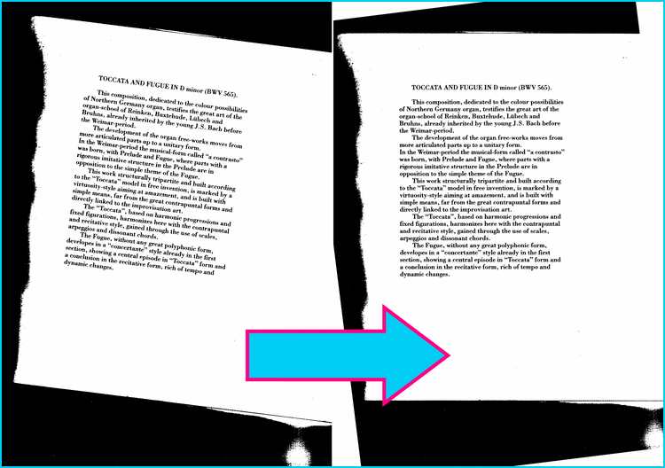

Deskew
=======================

by Marek Mauder  
<https://github.com/galfar/deskew>  
<https://galfar.vevb.net/deskew>  

**v1.35 2026-11-23**

- [Overview](#overview): [Downloads And Releases](#downloads-and-releases)
- [Usage](#usage): [Examples](#examples), [What Deskew Tells You](#what-deskew-tells-you), [Platform Notes](#platform-notes),
  [Bugs, Issues, Proposals](#bugs-issues-proposals)
- [Version History](#version-history)
- [Compiling Deskew](#compiling-deskew)

Overview
------------------------

Deskew is a command line tool for deskewing scanned text documents.
It uses Hough transform to detect "text lines" in the image. As an output, you
get an image rotated so that the lines are horizontal.

**Scanned page -> after `deskew page.png`**
 

---

It tells you when it cannot do its job: blank pages and pages without any text lines
are recognized and left as they are instead of being rotated by some random angle.

GUI frontend for this CLI tool is available as well (Windows, Linux, and macOS), see [GUI's Readme](Gui/Readme.md).

WebUI runs Deskew in your web browser, no installation needed: <https://galfar.github.io/deskew-webui>.
It is the same CLI tool compiled to WebAssembly, so images are processed on your computer and never uploaded. See [WebUI's Readme](Web/Readme.md).

License: MPL 2.0

### Downloads And Releases

<https://github.com/galfar/deskew/releases>  

There is one archive for each platform. It contains the command line tool, the GUI,
documentation and a few example images with a script to try them out. The WebUI archive
is a static site to host anywhere or run locally (see [WebUI's Readme](Web/Readme.md#running-locally)).

| Platform | Archive |
|---|---|
| Windows 64-bit | `deskew-1.35-win-x64.zip` |
| Windows 32-bit | `deskew-1.35-win-x86.zip` |
| Linux x86_64 | `deskew-1.35-linux-x64.zip` |
| Linux ARM 64-bit (aarch64) | `deskew-1.35-linux-arm64.zip` |
| macOS Apple Silicon | `deskew-1.35-macos-arm64.zip` |
| macOS Intel | `deskew-1.35-macos-x64.zip` |
| WebUI (any modern web browser) | `deskew-1.35-web.zip` |

See [Platform Notes](#platform-notes) for what each of them needs.

**Scoop** (Windows, command line tool and GUI):

```powershell
scoop bucket add deskew https://gitlab.com/deskew/scoop.git
scoop install deskew/deskew
```

**Homebrew** (macOS, command line tool only, built from source):

```bash
brew tap deskew/tap https://gitlab.com/deskew/homebrew.git
brew install deskew/tap/deskew
```

**Docker** (Linux amd64 and arm64, command line tool only), files of the current folder in `/data`:

```bash
docker run --rm -v "$PWD:/data" --user "$(id -u):$(id -g)" ghcr.io/galfar/deskew -o out.png scan.png
```

**Development snapshot**

<https://github.com/galfar/deskew/releases/tag/snapshot>  
Archives of the latest successful build of the development version, the same as above with
`dev-<date>` in the name. Tested by CI, but not as much as the releases.

Usage
------------------------

```console
Usage: deskew [-o output] [-a angle] [-b color] [..] input
    input:         Input image file
    -h:            Show this help

  Options:
    -o output:     Output image file name (default: deskewed-<input name>.png
                   next to the input file if none given) or a directory (existing
                   or with trailing slash) where output goes with input file name
    -b color:      Background color in hex format RRGGBB|LL|AARRGGBB (default: black)
    -q filter:     Resampling filter used for rotations (default: linear,
                   values: nearest|linear|cubic|lanczos)
    -a angle:      Maximal expected skew angle (both directions) in degrees (default: 10)

  Advanced options:
    -d angle:      Angle step during detection in degrees (default: 0.1)
    -t a|level:    Auto threshold or level in 1..255, darker pixels are
                   considered to be text (default: auto)
    -m margins:    Page margins left out of skew detection:
                   L,T,R,B[,unit] or H,V[,unit] or A[,unit] (default: whole page)
                   unit: px|%|mm|cm|in (default: px)
    -r rect:       Skew detection only inside content rectangle:
                   L,T,R,B[,unit] or auto (default: whole page)
                   unit: px|%|mm|cm|in (default: px)
                   auto: content area is found automatically for each image
    -f format:     Force output pixel format (values: b1|g8|rgb24|rgba32)
    -p dpi:        Print resolution of the image in DPI, overrides the one stored
                   in the input file (default: use the stored one)
    -l angle:      Skip deskewing step if skew angle is smaller, in degrees (default: 0.01)
    -g flags:      Operational flags (any combination of):
                   c - crop to input size, d - detect only (no output to file),
                   f - force rotation: also when the skew angle is not reliable
                   or smaller than the skip angle (-l)
    -s info:       Info dump (any combination of):
                   s - skew detection stats, p - program parameters, t - timings,
                   l - libraries used for zlib, JPEG, TIFF and WebP (shared or built in),
                   w - save work image to <output file name>.work.png: thresholded,
                       detection area framed red, found content green,
                   j - JSON report to standard output (and nothing else there),
                   r - JSON report to file <output file name>.json
    -c specs:      Output file format specs (compression etc.). Several specs
                   can be defined - delimited by commas. Supported specs:
                   jXX - JPEG compression quality, XX in range [1,100(best)]
                   tSCHEME - TIFF compression scheme: none|lzw|rle|deflate|jpeg|g4|input|input-lossless

  Skew angle is positive when the content is turned clockwise (text lines go down
  to the right), image is then rotated counterclockwise by this angle to fix it.

  Supported file formats
    Input:  BMP, JPEG, PNG, GIF, QOI, TGA, PBM, PGM, PPM, TIFF, WEBP
    Output: BMP, JPEG, PNG, GIF, QOI, TGA, PGM, PPM, TIFF
```

All the options, the JSON report and more are described in [Docs/Usage.md](Docs/Usage.md).

### Examples

Deskew a page with default settings. The result is saved next to the input as `deskewed-page.png`:

```console
deskew page.png
```

Choose the output file and fill the corners around the rotated page with white instead of black:

```console
deskew -b ffffff -o straight/page.png page.png
```

JPEG in, JPEG out with quality 85. Keep the size of the page the same as the input (corners are cropped):

```console
deskew -b ffffff -g c -c j85 -o page-straight.jpg page.jpg
```

Black and white (1-bit) TIFF. The output would be 8-bit grayscale by default, `-f b1` keeps it 1-bit
(it gets Group 4 fax compression in TIFF):

```console
deskew -f b1 -b ff -o page-straight.tif page.tif
```

Keep the compression of the input TIFF, but never compress with lossy JPEG again:

```console
deskew -c tinput-lossless -o out.tif in.tif
```

Page skewed a lot: raise the max angle from the default 10 degrees:

```console
deskew -a 30 -o out.png in.png
```

Punch holes, borders or pictures confuse the detection: look for the skew only in the middle of the page
(leave out 10 % along each edge), or let Deskew find the content area:

```console
deskew -m 10,% -o out.png in.png
deskew -r auto -o out.png in.png
```

Find only the skew angle, write no image:

```console
deskew -g d page.png
```

Get the results in JSON for a script, on standard output or in a file next to the output image
(`out.png.json`). The report is described in [Docs/Usage.md](Docs/Usage.md#json-report):

```console
deskew -s j -g d page.png 2>/dev/null | jq .detection.skewAngle
deskew -s r -o out.png in.png
```

Output can also be a folder (with trailing slash, or one that exists), the result keeps the name
of the input there. Deskew all PNG files in a folder into another one:

```console
# Linux, macOS (bash)
for f in scans/*.png; do deskew -b ffffff -o out/ "$f"; done

# Windows (cmd)
for %f in (scans\*.png) do deskew -b ffffff -o out\ "%f"

# Windows (PowerShell)
Get-ChildItem scans\*.png | ForEach-Object { .\deskew -b ffffff -o out\ $_.FullName }
```

Scanned PDFs, multi-page TIFFs and OCR with other free tools (poppler, img2pdf, libtiff tools, Tesseract):
see [Docs/Usage.md](Docs/Usage.md#pdf-multi-page-tiff-and-ocr).

### What Deskew Tells You

```console
Calculating skew angle using threshold 201...
Skew angle found [deg]: -1.210
Detection confidence: 100%
Rotating image...
```

Skew angle is positive when the content is turned clockwise. Confidence says how much the found
angle stands out from the others. When there is nothing to detect the skew from (blank page) or the lines
on the page have no clear direction, the image is not rotated and Deskew says why. It still ends
with success and writes the output, so batch jobs go on. `-g f` forces the rotation (also of pages
skewed by less than the skip angle).
More about it is in [Docs/Usage.md](Docs/Usage.md#what-the-detection-reports).
Scripts can get all of this as [JSON report](Docs/Usage.md#json-report) with `-s j` or `-s r`.

### Platform Notes

**No libraries are needed**: all the file formats, TIFF included, are read and written by code
built into Deskew on every platform. When zlib, libjpeg-turbo (2.0 or newer), libtiff or libwebp
are installed on the system (Windows and macOS: also next to the executable), Deskew uses them instead,
they are usually faster. `deskew -s l` shows what is used. Saving WebP needs libwebp.

**macOS** binaries are not notarized. When macOS refuses to start a downloaded application, remove the quarantine flag
from the extracted folder: `xattr -dr com.apple.quarantine <folder>`.

**Linux** GUI (`deskewgui`) uses Qt6: it needs Qt6 libraries of your distribution (Debian and Ubuntu:
`libqt6printsupport6`, Fedora: `qt6-qtbase-gui`, Arch: `qt6-base`), `libQt6Pas.so.6` that connects it
to Qt6 is in the archive next to it. Desktop installations often have no Qt6 (Ubuntu does not), then
`deskewgui` does not start: install the package above, or run it from a terminal to see the missing
library. `deskewgui-gtk2` is the same GUI with GTK2 for systems that have GTK2 but no Qt6 (Ubuntu 24.04
has it, 26.04 does not). Binaries are built on Ubuntu 24.04.
`unzip` keeps the executable permission of the files in the archive. If your archive tool does not,
set it after the extraction: `chmod +x deskew deskewgui deskewgui-gtk2`.

**Large images** (several GiB of pixels) are supported in 64-bit builds, see [Docs/Usage.md](Docs/Usage.md#large-images) for limits.

### Bugs, Issues, Proposals

File them here:  
<https://github.com/galfar/deskew/issues>  
<https://github.com/galfar/deskew/discussions>  


Version History
------------------------

**Planned for the next major version** (subject to change, ideas and feedback welcome in [Discussions](https://github.com/galfar/deskew/discussions)):

- accuracy measured on the public [DISE-2021](https://huggingface.co/datasets/phamquiluan/DISE-2021) benchmark: published numbers, and every change of the detection checked against them
- better metadata handling: EXIF, XMP and PNG text chunks kept in the output (#69), keep ICC color profiles, Software tag and a record of the rotation written into the file, better DPI handling
- easier use in scripts and pipelines: quiet mode and version output (#19), standard input and output as image files (#22)
- further optimizations of skew detection
- new improvements from Imaging: optimized PNG and JPEG support, faster image rotations, WebP encoder built-in, maybe JPEG XL and JPEG 2000 support

**v1.35 2026-11-23**:

- skew detection tells when it cannot be trusted: blank pages and pages without text lines are not rotated anymore (#71, thanks to jmaslak for the first take on it in PR #52), detection confidence is printed, `-g f` forces the rotation
- more robust skew angle: a few long lines (edges of pages in book scans, borders) cannot outvote the text anymore
- new `-r auto`: skew detection only in automatically found content area (#43)
- new `-m`: content area defined by page margins (#31)
- content rectangle and margins in pixels, percents, millimeters, centimeters or inches
- new `-d`: angle step of the detection (#58)
- new `-p`: print resolution (DPI) override (#11)
- new `-c tinput` and `tinput-lossless`: TIFF output compression same as of the input (#30)
- new `-s j` and `-s r`: machine readable JSON report on standard output or in a file
- skew detection is 3 to 5 times faster on large and dense pages: for example, detection on a 134 Mpx scan dropped from 28 s to 5 s
- new `-h`, invalid values of options and unknown options are refused with a clear message (#68)
- fix: wrong automatic threshold for scans with more than 16.7 million pixels of one gray level (e.g. A4 at 600 DPI)
- fix: rotation with nearest filter read past the end of the image
- fix #44: impossible to set background color to fully transparent
- fix #32: auto thresholding honors the content rectangle
- fix #20: saving output file in unsupported format silently failed
- fix #54: TIFF G4 compression forces 1-bit pixel format
- default output file name is `deskewed-<input name>.png` next to the input file (#28)
- `-o` can be a folder, the output gets the name of the input file there
- output that would overwrite the input file is refused
- new `-s l`: shows the libraries used for zlib, JPEG, TIFF and WebP
- work image of `-s w` is named after the output file (`<output file name>.work.png`), has the detection area and the found content marked
- "auto crop" flag is now "crop to input size"
- TIFF is read and written without libtiff on all platforms, zlib, libjpeg-turbo, libtiff and libwebp are used when the system has them
- BigTIFF, QOI and WebP file formats, images with over 4 GiB of pixel data and over 2^31 pixels (#73)
- **DDS, MNG, JNG and PSD file formats are not supported anymore**
- less memory needed: about 2 times the size of the image for deskewing, 1.4 times for detect only
- macOS and Linux ARM64 builds
- WebUI: Deskew running in the web browser (WebAssembly)
- releases have one archive for each platform, with CLI and GUI together

Changes in all the earlier versions are in [Docs/History.md](Docs/History.md).


Compiling Deskew
------------------------

Deskew is written in Object Pascal, you need Free Pascal (Lazarus for the GUI) or Delphi
to compile it. Everything else is in the repository, [Vampyre Imaging Library](https://github.com/galfar/imaginglib) included.
Projects, build commands, options, tests and supported platforms are described in
[Docs/Building.md](Docs/Building.md).

### Source Code

Latest source code can be found here:  
<https://github.com/galfar/deskew>
